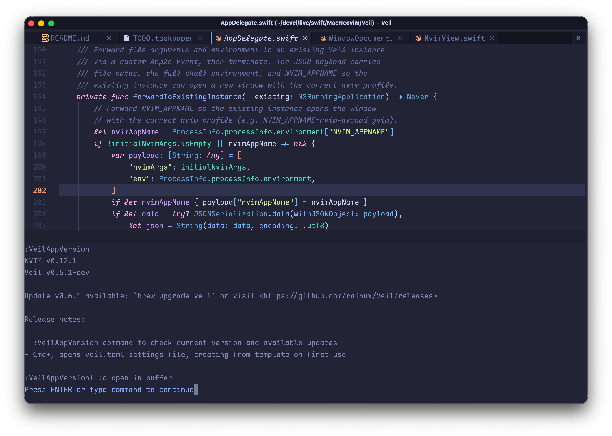

# Veil

<p align="center">
  
</p>

A Neovim GUI built for efficiency, not for cool.

Your Neovim config in proper macOS windows, in the tradition of MacVim. Instant startup with near-zero overhead, fast Metal rendering, fast multi-tab session loading. Designed for focus. No visual noise, no distractions.

### Why another Neovim GUI?

Veil brings the MacVim workflow to Neovim: multiple independent windows in a single app, `` Cmd+` `` to switch between projects, `Cmd+1/2/3` to jump to tabs. As a native macOS app instead of a terminal process, nearly all key sequences reach Neovim without being intercepted.

Vim is a tool built for focused, efficient work. Animations consume attention. Cursor effects, scroll easing, transition flourishes all pull your eyes away from what really matters: the text. Veil chooses to keep things quiet.

## Features

- **MacVim-tradition multi-window**: each window runs an independent Neovim, `Cmd+N` to create, `` Cmd+` `` to cycle.
- **Tabs**: Neovim drives the tabline by default; opt into native macOS tabs with `native_tabs = true`.
- **Instant startup**: sub-second cold start with fast multi-tab session loading.
- **Pixel-perfect Metal rendering**: GPU-accelerated, with continuous box-drawing lines and programming ligature support.
- **Native macOS keyboard handling**: most key sequences reach Neovim untouched; app shortcuts and Neovim keymaps both configurable. See [KEYBOARD.md](KEYBOARD.md).
- **Per-window profiles**: pick a different `NVIM_APPNAME` per window with `Cmd+Shift+N`.
- **Remote Neovim**: connect to a remote Neovim over TCP, with local clipboard integration.
- **Display forwarding**: run `veil` in a shell on another machine and the window opens on the machine you are typing on.
- **CJK ready**: auto-fallback to matching CJK font variants with full IME support.

<p align="center">
  
</p>

## Requirements

- macOS 14+
- Neovim 0.10+ recommended (install via `brew install neovim`)

Veil uses your system-installed Neovim. No bundled binary, ~1 MB download. Veil finds nvim anywhere your interactive shell can access it, and caches the resolved path so only the first launch pays the detection cost.

Veil communicates with Neovim via its stable msgpack-RPC and `ext_linegrid` UI protocol, and works with any recent Neovim version. The RPC layer is heavily optimized with event batching for responsive rendering.

## Install

Veil has two variants: the standard build, and a `default-editor` build that claims file associations on install (so double-clicking source files in Finder opens Veil).

### Homebrew

```bash
brew tap 0x1b2c/veil
brew install --cask veil                  # standard
brew install --cask veil-default-editor   # claims file associations
```

This installs `Veil.app` to `/Applications` and symlinks the `veil`, `gvim`, and `gvimdiff` CLI commands to your Homebrew bin directory. If another program (typically MacVim) already owns the `gvim` or `gvimdiff` name, Veil leaves it untouched; the install output shows how to claim it by hand.

### Manual

Download `Veil.zip` (standard) or `Veil-default-editor.zip` (claims file associations) from [Releases](https://github.com/0x1b2c/Veil/releases), unzip, and move `Veil.app` to `/Applications`. Then remove the quarantine attribute so macOS doesn't block it:

```bash
xattr -cr /Applications/Veil.app
```

### Signing and macOS permissions

Veil deliberately has no Apple Developer certificate. Obtaining one means accepting a central authority's approval over who may distribute software, and this project declines that arrangement. Release artifacts instead carry an ad-hoc signature whose designated requirement is `identifier "org.1b2c.Veil"`. macOS ties permission grants (folder access, Full Disk Access) to that requirement, so grants persist across updates instead of being invalidated by each new binary.

The trade-off: ad-hoc signatures have no certificate anchor, so any other program running on your Mac can sign itself with Veil's identifier and inherit the permissions you granted to Veil. Grant permissions with that in mind.

If you prefer the stricter binding, re-sign the installed app:

```bash
codesign -fs - /Applications/Veil.app
```

This replaces the signature with a default ad-hoc one bound to the exact binary, removing the impersonation exposure for grants made afterwards. Grants made before re-signing keep the identifier-based requirement TCC recorded at grant time; revoke and re-grant them to complete the switch. The cost is that every Veil update invalidates your grants and you must grant them again.

### Updates

Veil never prompts you to upgrade. This is by design: an update is something you ask about, not something the app announces, let alone forces on you. Run `:VeilAppVersion` when you want to know: it shows the current version, and if a newer release exists, its release notes and how to upgrade (`brew upgrade veil`, or the Releases page for manual installs). The update check runs once at app launch; restart Veil to refresh it.

## Build

Open `Veil.xcodeproj` in Xcode and run, or use [just](https://github.com/casey/just) (`brew install just`):

```
just                # Release build (arm-only, fast)
just debug          # Debug build
just test           # Run unit tests
just install        # Build + install to /Applications
just install-polite # Build + install + strip LSHandlerRank from /Applications/Veil.app
just zip            # Universal build + package as Veil-default-editor.zip
just zip-polite     # Universal build + package as Veil.zip (polite variant)
just clean          # Clean build artifacts
just lsp            # Generate buildServer.json for SourceKit-LSP
```

`just --list` shows every recipe with a one-line description.

For Neovim/editor LSP support, run `just lsp` after cloning to generate `buildServer.json` (requires [xcode-build-server](https://github.com/nicklockwood/xcode-build-server)).

## Usage

Veil reads your existing Neovim configuration (`~/.config/nvim/`) for editor behavior. Veil's own settings (font, keyboard shortcuts, remote bookmarks, and a few other options) live in `~/.config/veil/veil.toml`, separate from nvim's config. All fields are optional and have sensible defaults; see [`veil.sample.toml`](veil.sample.toml) for the full reference. Changes take effect on the next new window.

Set `VEIL_CONFIG` to load the config from a different path, useful for managed setups (e.g. Nix/home-manager) that generate the file elsewhere. The app reads it from its own environment at launch, so setting it when the CLI forwards to a running instance does not change the app's settings. The `veil` CLI reads `workspace_host` (see [Display forwarding](#display-forwarding)) from the same file, and looks for that file through `VEIL_CONFIG` in its own environment.

### Font

We recommend [Maple Mono](https://github.com/subframe7536/maple-font) for its excellent CJK support and Nerd Font icons:

```bash
brew install font-maple-mono-nf-cn    # or font-maple-mono-nf without CJK
```

Set it in nvim:

```lua
vim.o.guifont = 'Maple Mono NF CN:h16'    -- or 'Maple Mono NF:h16' without CJK
```

Or in `~/.config/veil/veil.toml` (recommended for remote nvim connections, where the remote machine's `guifont` rarely matches your local Mac):

```toml
[font]
family = "Maple Mono NF CN"    # or "Maple Mono NF" without CJK
size = 16.0
```

See [FONT.md](FONT.md) for precedence rules, the `force` option, and Nerd Font fallback details.

### Keyboard

Veil's keybindings split into two categories: **app shortcuts** for Veil's own actions (new window, close tab, open settings, etc.) and **Neovim keymaps** for macOS-style shortcuts pre-bound to Neovim commands (`cmd+s` → `:w`, `cmd+1`-`9` → switch tabs, etc.). Both are configurable, and the Neovim keymaps can be disabled wholesale to free those keys for your own nvim mappings. The Option key defaults to typing layout-defined characters (UK `#`, German brackets, dead-key accents); set `option_as_meta` to make one or both Option keys send `<M-...>` to nvim instead. See [KEYBOARD.md](KEYBOARD.md) for the full list and string format.

Quick reference:

| Key                | Action                                |
| ------------------ | ------------------------------------- |
| `Cmd+N`            | New window                            |
| `Cmd+Shift+N`      | New window with profile picker        |
| `Cmd+W`            | Close tab (or window if only one tab) |
| `Cmd+Shift+W`      | Close window                          |
| `Cmd+Q`            | Quit Veil                             |
| `` Cmd+` ``        | Cycle windows                         |
| `Cmd+1` – `Cmd+9`  | Switch tab                            |
| `Cmd+,`            | Open settings (veil.toml)             |
| `Cmd+Ctrl+Shift+N` | Connect to remote nvim                |
| `Cmd+Ctrl+Shift+W` | Close window and quit its Neovim (terminates a remote server) |

Each of these stays at the granularity macOS users expect: `Cmd+W` closes one tab, `Cmd+Shift+W` closes the window, `Cmd+Q` quits the entire app. Unsaved-buffer prompts route through Neovim's `:confirm qa`.

### Remote Neovim

Veil can connect to a Neovim instance running on a remote machine over TCP. Start Neovim on the remote host listening on localhost:

```bash
nvim --headless --listen 127.0.0.1:6666
```

Neovim's RPC protocol has no authentication, so for a connection you set up yourself, bind to `127.0.0.1` and use SSH tunneling as shown below rather than exposing the listening port to the network. [Display forwarding](#display-forwarding), described below, connects directly over Tailscale instead, and explains that trade-off there.

Forward the port over SSH, then connect from Veil using `Cmd+Ctrl+Shift+N`:

```bash
# -L local_port:remote_host:remote_port
ssh -L 6666:127.0.0.1:6666 your-server
```

For a persistent setup, add to `~/.ssh/config`:

```properties
Host dev-nvim
    HostName your-server
    # local_port remote_host:remote_port
    LocalForward 6666 127.0.0.1:6666
```

Then `ssh dev-nvim` automatically forwards the port. Use `ssh -N dev-nvim` to forward without opening a shell.

You can save frequently used connections in `veil.toml`:

```toml
[[remote]]
name = "Dev Server"
address = "127.0.0.1:6666"

[[remote]]
name = "Staging"
address = "127.0.0.1:6667"
```

> _I don't always code, but when I do, I code in ~~production~~._

Connections can also be scripted through the CLI: `veil --veil-connect host:port --veil-workspace name` connects to that address, or just activates the window already connected to it. A window that failed to connect keeps showing the error until you connect to that address again, by either route, which closes it and tries afresh. `--veil-workspace` names the window while the connection is being established. `--veil-connect` refuses file arguments, since their paths belong to this machine; open files with `veil` on the machine running that nvim.

Clipboard integrates seamlessly with your local Mac. Yank/paste with `+` and `*` registers in the remote session operates on your local pasteboard.

### Display forwarding

Run `veil foo.txt` in a shell on another machine, and the window opens on the machine you are typing on, connected to an nvim that stays on the machine holding the files. Like `ssh -X`, it is transparent: the same command works whether you typed on this machine or another. It currently requires WezTerm on both machines: run the shell in a WezTerm mux, and attach to that mux from the WezTerm on your machine. WezTerm is what tells Veil where you are typing, and what carries the request to open a window back to your machine.

Veil asks wezterm which attached client's keyboard just issued the command; when that client is on another machine, instead of opening a window on the mux host it maintains one headless nvim per project root (spawned on demand, tracked in `~/.local/state/veil/registry.json`), sends the files into it, and emits a `veil-edit` user var that wezterm broadcasts to attached clients.

Veil ships the wezterm handler that answers it. On each machine running Veil, add one line to `wezterm.lua`:

```lua
dofile("/Applications/Veil.app/Contents/Resources/veil-wezterm.lua")
```

With Veil installed in `~/Applications`, write that path instead. The script registers a `user-var-changed` handler, which looks for the `veil` CLI in `/Applications/Veil.app` and then `~/Applications/Veil.app` and logs an error to wezterm's debug overlay when neither has it. wezterm evaluates its configuration afresh on every reload, so reloading never leaves a second copy of the handler behind.

The user var's value is a JSON object such as `{"host": "100.101.102.103", "port": 7001, "viewer": "a2", "workspace": "proj"}`. `host` and `port` are the address the workspace's nvim listens on, `workspace` names the window, and `viewer` is the hostname of the machine whose keyboard issued the command, reduced to its first label and lowercased. The broadcast reaches every machine attached to the mux, but only the viewer acts on it: each handler reduces the hostname wezterm reports for its own machine in the same way, and runs `veil --veil-connect host:port --veil-workspace name` only when the result equals `viewer`. The window therefore opens on the machine you typed on, even when wezterm windows on other machines are attached to the same mux. The handler acts only on a request raised in a pane of an attached mux. Text that merely shows up in one of the GUI's own local panes, such as a file printed with `cat` or the output of an SSH session to another host, is logged and ignored, so it cannot choose the address Veil connects to. A `port` that is not an integer between 1 and 65535 is rejected the same way.

The headless nvim listens on the Tailscale IPv4 address of the machine running it, so the viewer connects directly over the tailnet. The address is used rather than the machine's MagicDNS name because a local DNS proxy in fake-IP mode can answer that name with an address the machine does not own, which nvim cannot listen on. To listen on another address, set `workspace_host` in `veil.toml` on that machine to one IPv4 address or name, without a port; a wildcard such as `0.0.0.0` or an IPv6 address is reported and ignored. With neither available (Tailscale stopped or logged out counts as unavailable), `veil` exits with an error asking for `workspace_host`. Unlike the manual setup above, this goes through no SSH tunnel. nvim accepts commands on that address without authentication, so display forwarding treats the tailnet as a trusted network, which holds only while the tailnet contains nothing but your own devices, or while Tailscale ACLs restrict who can reach those ports. This is a deliberate trade-off: a direct connection needs no tunnel to be opened, kept alive, and closed for each workspace, which keeps the setup simpler and more reliable. Writing a LAN address in `workspace_host` exposes the workspace to every machine on that network; how far it is exposed is then your decision.

Of nvim's own arguments, `+cmd`, `-R`, and `-d` (so `gvimdiff` too) carry over into the workspace, and as with a local nvim a `+cmd` that fails reports its error while the file still opens; arguments that only take effect when nvim starts, such as `-u` or `--clean`, are refused with an error. `veil --veil-local foo.txt` skips this detection and always opens the window on the machine running the command. Closing the Veil window only detaches; the workspace ends with `:qa` (or Cmd+Ctrl+Shift+W).

Run `veil --veil-workspaces` on the machine that hosts the workspaces to list them. The list shows the registered workspaces with the host and port each server listens on (a host in parentheses was never recorded and is assumed from the current one) and the state of each server: `alive`, `busy` (running but not answering, for example while nvim waits on `:!cmd`), `unreachable` (running, but the address it listens on is no longer on this machine, no longer resolves, or refuses connections, for example after the network it was started on went away), `dead`, or `unknown` (a workspace registered by an older version, with no recorded address and no running server to read it from, while this machine has no address to serve on either; set `workspace_host` to probe it). A busy or unreachable workspace is never killed or replaced: `veil` reports it on stderr and exits with an error, so retry once the command finishes or the network the workspace was started on is back.

### Commands

Veil registers these commands in Neovim:

- `:VeilAppVersion` show Veil and Neovim version info, and check for updates. Use `:VeilAppVersion!` to open in a scratch buffer for easy copying
- `:VeilAppDebug` show/hide an overlay with renderer info, frame time, grid size, font details, and more. `:VeilAppDebug copy` copies the overlay's current contents to the system clipboard

## CLI

Veil ships CLI commands inside the app bundle: `veil`, plus `gvim` and `gvimdiff` as traditional aliases (`gvimdiff` is equivalent to `veil -d`). Symlink them to your PATH:

```bash
ln -s /Applications/Veil.app/Contents/bin/veil ~/.local/bin/veil
ln -s /Applications/Veil.app/Contents/bin/gvim ~/.local/bin/gvim
ln -s /Applications/Veil.app/Contents/bin/gvimdiff ~/.local/bin/gvimdiff
```

Then use it like nvim. All nvim flags and arguments are passed through transparently:

```bash
veil file.txt
gvim +42 file.txt               # open at line 42
gvim -p file1.txt file2.txt     # open in tabs
veil -d file1.txt file2.txt     # diff mode
gvimdiff file1.txt file2.txt    # same as veil -d
```

If Veil is already running, the CLI forwards arguments to the existing instance (opens a new window) instead of launching a second copy. Forwarding uses Apple Events, so the first time you do this from a given terminal, macOS asks whether that terminal may control Veil; allow it. If you declined, re-enable it in System Settings > Privacy & Security > Automation.

### Multiple nvim configs

Each window can run a different Neovim configuration. Use `NVIM_APPNAME` from the CLI or `Cmd+Shift+N` from the GUI to select which config directory under `~/.config/` nvim uses:

```bash
NVIM_APPNAME=astronvim veil              # launch Veil with astronvim config
NVIM_APPNAME=nvim-nvchad gvim file.txt   # open file with NvChad config
```

Create shell aliases for configs you use often:

```bash
alias gvi='NVIM_APPNAME=nvim-nvchad gvim'
gvi file.txt                             # just works, fresh launch or new window
```

## Background

MacVim introduced a workflow that set it apart from gVim: multiple independent windows in a single app, each with its own tabs, switching between projects instantly with `` Cmd+` ``. You could have three codebases open, `` Cmd+` `` between them, and `Cmd+1/2/3` to jump to specific tabs within each one.

In the Neovim era, most GUI frontends followed the gVim model: you can open multiple instances, but each is a separate process with no way to `` Cmd+` `` between them. VimR was the exception, bringing the MacVim multi-window experience to Neovim, but its Redux architecture made startup and multi-tab session loading noticeably slow.

Veil carries this tradition forward: a minimal, fast wrapper that gives Neovim first-class macOS citizenship. Multiple windows as independent workspaces, intuitive tab switching with `Cmd+1/2/3`, and as a native app instead of a terminal process, nearly all key sequences reach Neovim without being intercepted.

> **Note:** Neovide v0.16.0 also shipped macOS multi-window support within one day of Veil's first release, a fun coincidence. Neovide is an excellent choice if you prefer a cross-platform solution with visual effects. Veil focuses on being a minimal native macOS wrapper (~1 MB).

## Acknowledgments

Thanks to [VimR](https://github.com/qvacua/vimr) by Tae Won Ha. Veil learned a great deal from its implementation of the Neovim UI protocol, input handling, and macOS integration.

Box-drawing and block element rendering algorithms are ported from [Ghostty](https://github.com/ghostty-org/ghostty) (MIT License).

Glyph overflow strategy inspired by [WezTerm](https://github.com/wez/wezterm): when a glyph (e.g. Nerd Font icon) is wider than its allocated cell, Veil renders it at full natural width if followed by a space, or shrinks it to fit otherwise.

## License

MIT
